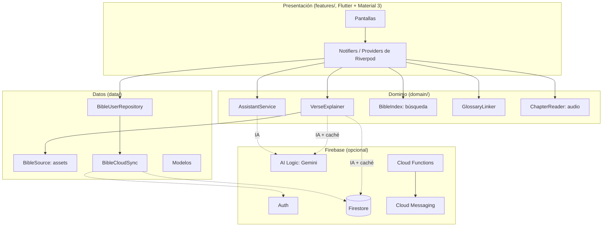

# Arquitectura

## 1. Visión general

La app es **offline primero**. Todo lo esencial viene empaquetado y funciona
sin internet:
- la Biblia completa;
- los estudios;
- la Escuela Bíblica;
- el glosario;
- las respuestas del asistente;
- los planes de lectura.

La nube (Firebase) **suma** cuatro cosas, y si falla la app sigue igual:
- la sincronización entre teléfonos;
- la IA para los versículos sin estudio y para las preguntas libres;
- la caché compartida de esas explicaciones;
- las notificaciones push.



## 2. Capas (Clean Architecture)

| Capa | Carpeta | Responsabilidad | Depende de |
|---|---|---|---|
| Presentación | `lib/features/`, `lib/shared/widgets/` | Pantallas y widgets. Sin lógica de negocio. | dominio, datos (modelos) |
| Estado (ViewModel) | `lib/app/providers.dart`, `lib/app/boricua_providers.dart` | Riverpod: `Notifier` / `FutureProvider` hacen de ViewModel (MVVM) | dominio, datos |
| Dominio | `lib/domain/` | Reglas: explicar un versículo, contestar una pregunta, buscar, leer en voz alta | modelos, interfaces |
| Datos | `lib/data/` | Modelos inmutables, repositorios (Repository Pattern) y fuentes (assets, Firestore) | Flutter, Firebase |
| Configuración | `lib/core/` | Edición (sabor), tema, normalización de texto, push | — |

Cada servicio de dominio es una **interfaz** con dos implementaciones, una sin
conexión y otra con IA que delega en la primera si falla:

| Interfaz | Sin conexión | Con Firebase |
|---|---|---|
| `VerseExplainer` | `StudyVerseExplainer` (estudios escritos a mano) | `AiVerseExplainer` (Gemini, con caché local y compartida) |
| `AssistantService` | `OfflineAssistant` (respuestas escritas a mano) | `AiAssistant` (Gemini; el texto bíblico sale siempre de la Biblia local) |
| `BibleCloudSync` | — (todo en el teléfono) | `FirestoreBibleSync` |

Los providers eligen la implementación según `firebaseReadyProvider`, y los
tests sobrescriben los providers para usar datos reales sin red.

## 3. Estructura de carpetas

```
lib/
  app/
    app.dart                  MaterialApp.router, tema, escala de texto
    router.dart               go_router; pestañas por edición (_boricuaBranches)
    shell.dart                navegación inferior
    providers.dart            contenido, preferencias, guardados, progreso
    boricua_providers.dart    Biblia, recursos, explicaciones, asistente, notas
  core/
    config/edition.dart       ediciones (sabores) y sus textos
    theme/                    paletas (bandera de PR) y tema Material 3
    push_notifications.dart   FCM: tema del versículo del día
    utils/text_normalizer.dart
  data/
    models/
      bible.dart              Bible, BibleBook, VerseRef
      bible_user_data.dart    VerseAnnotation, ChapterVisit, BibleUserData
      boricua_resources.dart  GlossaryTerm, SchoolLevel, Lesson, AssistantAnswer, ReadingPlan
      passage.dart            Passage (+ PassageStudy: paráfrasis y enseñanzas)
    repositories/
      bible_user_repository.dart   local + FirestoreBibleSync
    sources/bible_source.dart      assets empaquetados (decodifica en un isolate)
  domain/
    bible/bible_search.dart        índice de 31,102 versículos
    bible/verse_explainer.dart     estudio escrito a mano → IA → caché
    bible/glossary_linker.dart     detecta términos teológicos en un texto
    assistant/assistant_service.dart
    listening/                     voz, audio en segundo plano, notificación
  features/
    bible/      BibleScreen, ChapterScreen, VerseSheet, búsqueda, mis notas, audio
    passage/    estudio completo (StudyView)
    school/     Escuela Bíblica y lección
    assistant/  asistente cristiano
    glossary/   teología simple
    plans/      planes de lectura
    home/ search/ favorites/ settings/ …   (compartidas con las demás ediciones)
tool/boricua/
  build_biblia.py       genera biblia_rv1909.json desde la RV1909
  estudios.py           478 estudios escritos a mano (meta: 40 o más por libro)
  recursos.py           glosario, Escuela Bíblica y asistente
  build_boricua.py      valida (sin palabras antiguas, citas reales) y genera los JSON
functions/              Cloud Functions (TypeScript)
firebase/firestore.rules
test/data/boricua_edition_test.dart, test/widgets/boricua_screens_test.dart
```

## 4. Módulos

### Biblia y estudio de versículos
- **Navegación.** `BibleScreen` (Antiguo y Nuevo Testamento) abre `ChapterScreen`, y tocar un versículo abre `VerseSheet`.
- **Las cinco partes.** `VerseSheet` muestra: 1) texto bíblico, 2) paráfrasis boricua, 3) explicación simple, 4) aplicación práctica y 5) oración sugerida.
- **Términos.** Las «palabras clave» del glosario aparecen debajo de la explicación.
- **De dónde sale la explicación.** `AiVerseExplainer.explain` busca en este orden:
  1. el estudio escrito a mano;
  2. la caché del teléfono (`verse_ai_v1:<clave>`);
  3. la caché compartida en Firestore `verseStudies/<clave>`;
  4. Gemini.

  Lo que genera Gemini se guarda en las dos cachés, así que cada versículo se genera **una sola vez para todos los usuarios**.
- **Las instrucciones de la IA** (`AiVerseExplainer.systemPrompt`) prohíben las palabras antiguas y la jerga vulgar, y piden fidelidad a la fe cristiana histórica.

### Búsqueda avanzada
- `BibleIndex` normaliza los 31,102 versículos en un isolate (sin tildes ni mayúsculas).
- La búsqueda por palabras exige que estén todas (AND) y se puede filtrar por testamento.
- Las citas escritas a mano («jn 3:16», «sal 23», «1 Co 13») saltan directo al capítulo.
- La búsqueda de estudios por tema, problema, emoción o personaje reutiliza `SearchEngine` (con sinónimos) de las demás ediciones.

### Discipulado y Escuela Bíblica
- Son 7 niveles con 3 lecciones cada uno. Cada lección tiene lecturas (citas validadas contra la Biblia), explicación, reflexión, un ejemplo de la vida real y una oración guiada.
- El progreso se guarda en `lessonsDone` y se sincroniza.
- El nivel 7 forma a quien discipula a otros.

### Asistente cristiano
- **Sin conexión.** Compara la pregunta con las palabras clave de cada respuesta escrita.
- **Crisis.** Ante señales de suicidio o autolesión responde **siempre** con el 988, la Línea PAS (1-800-981-0023) y el 911, aunque haya IA.
- **Con IA.** Gemini devuelve solo la cita. La app la valida (`Bible.parse`) y pone el texto desde la Biblia local, así que nunca muestra un versículo inventado.

### Audio
- `ChapterReader` lee el capítulo versículo por versículo con la voz del teléfono.
- Usa el servicio de reproducción (notificación con controles y wake lock), así que sigue con la pantalla apagada.

## 5. Escalabilidad

| Aspecto | Decisión | Por qué escala |
|---|---|---|
| Lectura | La Biblia y los estudios son assets: cero lecturas de Firestore | El costo no crece con los usuarios |
| IA | Caché compartida por versículo | Como máximo 31,102 generaciones en total, no por usuario |
| Datos personales | Un documento por usuario (`users/{uid}`), escritura agrupada cada 3 s | Escrituras mínimas; sin consultas entre usuarios |
| Seguridad | Reglas por dueño, esquemas y límites de tamaño; App Check (Play Integrity) | Evita abuso de la IA y de la caché |
| Push | Un tema de FCM por edición | Un solo envío llega a millones de dispositivos |
| Rendimiento | Decodificación y normalización en isolates; listas perezosas | La interfaz no se traba con 4 MB de texto |
| Contenido | Versionado (`CONTENT_VERSION`) y publicación por Firestore (`tool/firestore/seed.mjs`) | Se puede actualizar sin publicar otra versión |

Cuando haga falta crecer más:
- **Búsqueda.** Una búsqueda semántica, con embeddings y Vertex AI Vector Search detrás de una Cloud Function.
- **Lectura del documento personal.** Pasar las notas a una subcolección si un usuario pasa de unas 20,000 anotaciones; el límite de un documento es 1 MiB.
- **Traducciones.** Varias, como assets descargables con Firebase Storage.
