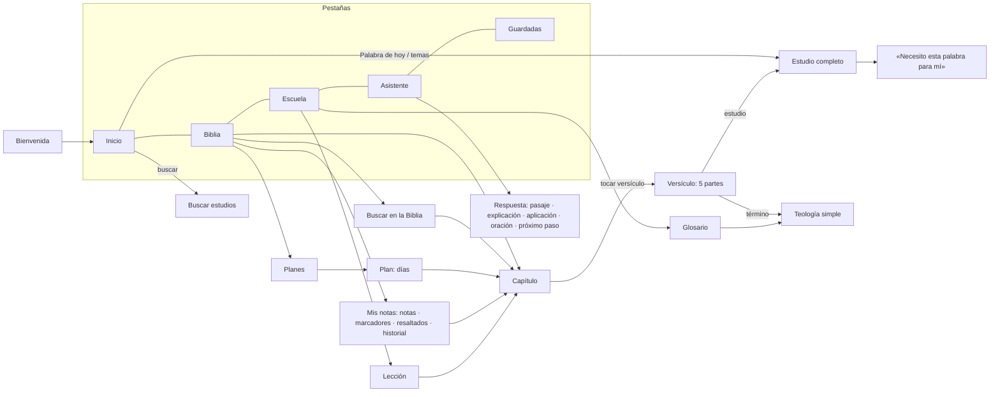

# UX/UI

## Principios
1. **Cercano y reverente.** Un creyente maduro sentado al lado: lenguaje claro, sin jerga vulgar ni tono de sermón.
2. **Primero la Palabra.** El texto bíblico siempre está visible; la paráfrasis y la explicación lo acompañan, no lo reemplazan.
3. **Un toque para entender.** Tocar cualquier versículo abre sus cinco partes, y los términos teológicos se explican con un toque.
4. **Sin conexión.** Leer, estudiar, buscar y escuchar no depende de la señal (se piensa en los apagones y en la falta de señal en el campo).
5. **Accesible.**
   - Letra grande ajustable (de 0.8× a 2×) y modo oscuro.
   - Contraste AA o mejor en las dos paletas.
   - Áreas táctiles de 48 dp como mínimo.
   - Lectura en voz alta de cualquier capítulo.

## Identidad visual
- **Paleta: los colores de la bandera de Puerto Rico** (`AppPalette.boricuaLight/Dark`):
  - azul del triángulo `#0A3D91` (en oscuro `#8FB4F5`);
  - rojo de las franjas `#C8102E` (en oscuro `#FF6B7D`), como color de acento;
  - fondo blanco (en oscuro, noche `#070B16`).
- **Tipografía:** serif clásica para títulos y citas, y sans legible para el cuerpo (las fuentes del proyecto).
- **Componentes Material 3:**
  - `NavigationBar` de 5 pestañas;
  - `SegmentedButton` para escoger testamento;
  - hojas inferiores para el versículo y para los términos;
  - tarjetas desplegables para las enseñanzas.

## Flujo de navegación



## Wireframes

```
┌─ Inicio ───────────────────┐  ┌─ Biblia ───────────────────┐  ┌─ Juan 3 ────────────── 🎧 ─┐
│ Biblia Boricua         ⚙︎  │  │ La Biblia          🔍  🔖  │  │ 1 Y había un hombre de los │
│ [🔍 Buscar un estudio…   ] │  │ ┌ Seguir leyendo: Juan 3 ┐ │  │   fariseos que se llamaba… │
│ ┌ PALABRA DE HOY ────────┐ │  │ ┌ Planes de lectura     ┐ │  │ …                          │
│ │ «Dios amó tanto al     │ │  │ [ Antiguo | Nuevo ]        │  │16 Porque de tal manera amó│
│ │  mundo…»  Juan 3:16-17 │ │  │ ── NUEVO TESTAMENTO        │  │   Dios al mundo…  (amarillo)│
│ └────────────────────────┘ │  │ (Mt) Mateo   28 capítulos  │  │ …                          │
│ ┌ Escuchar ───────────── ▶┐│  │ (Mr) Marcos  16 capítulos  │  │ [‹ Capítulo 2] [Capítulo 4›]│
│ ── DIOS HABLA SOBRE…       │  │ …                          │  └────────────────────────────┘
│ [Miedo] [Ansiedad] [Culpa] │  └────────────────────────────┘
│ [ Leer la Biblia completa ]│
├────────────────────────────┤  ┌─ Versículo (hoja) ─────────┐  ┌─ Asistente ────────────────┐
│ 🏠  📖  🎓  💬  🔖          │  │ Juan 3:16                  │  │ ¿Qué estás pasando?        │
└────────────────────────────┘  │ ── TEXTO BÍBLICO           │  │ [¿Cómo perdono?…      ➤]   │
                                │ Porque de tal manera…      │  │ (Por qué sufro) (Cómo oro) │
┌─ Escuela Bíblica ─── 💡 ───┐  │ 🟡🟢🔵🩷  🔖  ✎  ⇪          │  │ ── 1. PASAJE BÍBLICO       │
│ ▓▓▓░░░░ 6 de 21 lecciones  │  │ ┌ PARÁFRASIS BORICUA ────┐ │  │ «Soportándoos los unos…»   │
│ (1) Nivel 1: Conociendo    │  │ │ Dios amó tanto al mundo│ │  │ Colosenses 3:13            │
│     a Dios            ▾    │  │ └────────────────────────┘ │  │ ── 2. EXPLICACIÓN SENCILLA │
│   ✓ Dios existe y se da…   │  │ ── EXPLICACIÓN SIMPLE      │  │ ┌ 3. Aplicación práctica ┐ │
│   ○ Dios es amor y santo   │  │ Palabras clave: [💡 Fe]    │  │ ┌ 4. Oración sugerida    ┐ │
│ (2) Nivel 2: Conociendo    │  │ ── APLICACIÓN PRÁCTICA     │  │ ┌ 5. Próximo paso        ┐ │
│     a Jesucristo      ▾    │  │ ── ORACIÓN SUGERIDA        │  │ ⚠︎ Líneas de ayuda (crisis)│
└────────────────────────────┘  │ [🎓 Estudio completo]      │  └────────────────────────────┘
                                └────────────────────────────┘
┌─ Estudio completo ─────────┐
│ Juan 3:16-17               │
│ ┌ LOS VERSÍCULOS COMPLETOS┐│
│ ── PARÁFRASIS BORICUA      │
│ 16 Dios amó tanto…         │
│ ▸ Contexto                 │
│ ── ¿QUÉ PASÓ AQUÍ?         │
│ ── EXPLICACIÓN SIMPLE      │
│ ▾ ¿Qué nos enseña de Dios? │
│ ▾ …del ser humano?         │
│ ▾ …de Jesucristo?          │
│ ┌ ¿Cómo lo aplico hoy? ──┐ │
│ ┌ 🙏 Oración sugerida ───┐ │
└────────────────────────────┘
```
